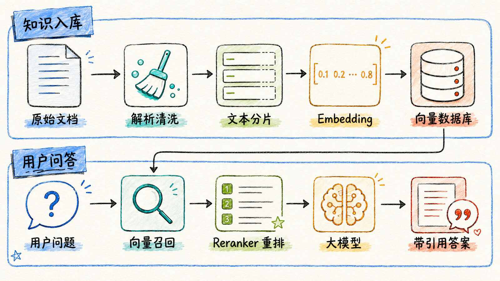

## 基础原理

### 什么是 RAG？

检索增强生成，是一种在 Agent 调用 LLM 来生成回答之前，先从外部知识库检索出相关信息，再整合进 Context 一起送给 LLM 的技术。

### RAG 的工作流程

#### 离线索引阶段

1. 文档处理：从PDF、网页、数据库等多种数据源获取文档，解析和清洗之后，会将长文档切分为适合检索的小块-chunk
   - 固定大小分块
   - 语义分块
   - 递归分块：依次尝试标题、段落、句子等分隔符
   - chunk_size：定义 chunk 的大小
   - chunk_overlap：每个 chunk 跟它相邻的 chunk 首尾都会有一些重叠，有助于减少信息损失
2. 嵌入（Embedding）：将文本转换为高维向量，捕捉语义信息。
   - 常用模型：OpenAI text-embedding-3-small、BGE、E5
   - 中文模型：BGE-zh、千问
3. 向量存储
   - Chroma：简单方便，一般用于开发测试
   - Milvus：分布式架构，一般用于生产环境

#### 在线查询阶段

1. Query 向量化
2. 向量检索
   - 稀疏检索：BM25 关键词匹配，精确但无语义解释
   - 密集检索：向量相似度，理解语义但可能丢失精确度
   - 混合检索：稀疏 + 密集，效果最佳
   - 重排序（Reranking）：对检索结果进行二次排序
     - BGE-Reranker
3. 拼接上下文：将检索到的文档块拼入 Prompt
4. LLM 根据上下文来生成回答，同时会携带引用来源

## 进阶技巧

### Query 改写

- HyDE：先让 LLM 生成假设性答案，再用该答案做检索，这样检索范围会尽可能覆盖答案
- Multi-Query：将原始 Query 改写成多个变体，分别检索然后合并
- Step-back Prompting：先问更抽象的问题，获取背景知识

### Agentic RAG

- 将 AI Agent 整合到 RAG 管道中，可以边想边查
- 由 Agent 主动决定：是否需要检索、用哪个数据源、检索结果是否足够
- 支持多数据源路由、迭代检索、自我反思

### Graph RAG

- 结合知识图谱，捕捉实体间的关系
- 适合需要推理和关系分析的场景